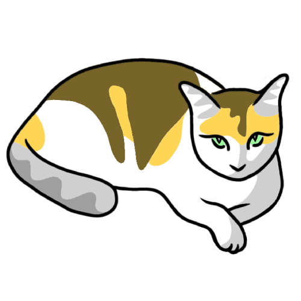

<h1>{title}</h1>

{tagline}

{version}

## {our-channels-title}

<h3>{newsletter-title}</h3>

{newsletter-description}

<form class="gato-about__newsletter-form" action="https://store.gatoplugins.com/?fluentcrm=1&route=contact&hash=7e623bde-a144-4e96-b0f3-0ed52034c5f9" method="POST" target="_blank">

<label for="newsletter-name">{name-label}</label>
<input type="text" name="full_name" id="newsletter-name" class="gato-input" required="" aria-required="true" placeholder="John Doe" autocomplete="name">

<label for="newsletter-email">{email-label}</label>
<input type="email" name="email" id="newsletter-email" class="gato-input" required="" aria-required="true" placeholder="your@email.com" autocomplete="email">

<button type="submit" class="button button-primary">{subscribe-button}</button>
</form>

{find-us-label}
<a class="gato-about__channel" href="https://gatographql.com" target="_blank"><svg width="18" height="18" viewBox="0 0 24 24" fill="none" stroke="currentColor" stroke-width="1.8" stroke-linecap="round" stroke-linejoin="round"><circle cx="12" cy="12" r="9"></circle><path d="M3 12h18"></path><path d="M12 3a14 14 0 0 1 0 18a14 14 0 0 1 0-18"></path></svg>{website-label}</a>
<a class="gato-about__channel" href="https://github.com/GatoGraphQL/GatoGraphQL" target="_blank"><svg width="18" height="18" viewBox="0 0 24 24" fill="none" stroke="currentColor" stroke-width="1.8" stroke-linecap="round" stroke-linejoin="round"><path d="M8 7l-5 5l5 5"></path><path d="M16 7l5 5l-5 5"></path><path d="M14 4l-4 16"></path></svg>{source-code-label}</a>
<a class="gato-about__channel" href="https://www.youtube.com/@GatoPlugins" target="_blank"><svg width="18" height="18" viewBox="0 0 24 24" fill="none" stroke="currentColor" stroke-width="1.8" stroke-linecap="round" stroke-linejoin="round"><rect x="3" y="5" width="18" height="14" rx="4"></rect><path d="M10 9l5 3l-5 3z"></path></svg>{youtube-label}</a>
<a class="gato-about__channel" href="https://gatographql.com/contact" target="_blank"><svg width="18" height="18" viewBox="0 0 24 24" fill="none" stroke="currentColor" stroke-width="1.8" stroke-linecap="round" stroke-linejoin="round"><rect x="3" y="5" width="18" height="14" rx="2"></rect><path d="M3 7l9 6l9-6"></path></svg>{contact-label}</a>

## {release-notes-title}

20.0
{current}

<a class="button button-primary" href="../../release-notes/20.0/en.md">{read-release-notes-button}</a>

{release-notes-intro}

19.x

<a href="../../release-notes/19.3/en.md">19.3</a>
<a href="../../release-notes/19.2/en.md">19.2</a>
<a href="../../release-notes/19.1/en.md">19.1</a>
<a href="../../release-notes/19.0/en.md">19.0</a>

18.x

<a href="../../release-notes/18.0/en.md">18.0</a>

17.x

<a href="../../release-notes/17.1/en.md">17.1</a>
<a href="../../release-notes/17.0/en.md">17.0</a>

16.x

<a href="../../release-notes/16.1/en.md">16.1</a>
<a href="../../release-notes/16.0/en.md">16.0</a>

15.x

<a href="../../release-notes/15.3/en.md">15.3</a>
<a href="../../release-notes/15.2/en.md">15.2</a>
<a href="../../release-notes/15.1/en.md">15.1</a>
<a href="../../release-notes/15.0/en.md">15.0</a>

14.x

<a href="../../release-notes/14.0/en.md">14.0</a>

13.x

<a href="../../release-notes/13.2/en.md">13.2</a>
<a href="../../release-notes/13.1/en.md">13.1</a>
<a href="../../release-notes/13.0/en.md">13.0</a>

12.x

<a href="../../release-notes/12.2/en.md">12.2</a>
<a href="../../release-notes/12.1/en.md">12.1</a>
<a href="../../release-notes/12.0/en.md">12.0</a>

11.x

<a href="../../release-notes/11.3/en.md">11.3</a>
<a href="../../release-notes/11.2/en.md">11.2</a>
<a href="../../release-notes/11.1/en.md">11.1</a>
<a href="../../release-notes/11.0/en.md">11.0</a>

10.x

<a href="../../release-notes/10.5/en.md">10.5</a>
<a href="../../release-notes/10.4/en.md">10.4</a>
<a href="../../release-notes/10.3/en.md">10.3</a>
<a href="../../release-notes/10.2/en.md">10.2</a>
<a href="../../release-notes/10.1/en.md">10.1</a>
<a href="../../release-notes/10.0/en.md">10.0</a>

2.x – 9.x

<a href="../../release-notes/9.0/en.md">9.0</a>
<a href="../../release-notes/8.0/en.md">8.0</a>
<a href="../../release-notes/7.0/en.md">7.0</a>
<a href="../../release-notes/6.0/en.md">6.0</a>
<a href="../../release-notes/5.0/en.md">5.0</a>
<a href="../../release-notes/4.2/en.md">4.2</a>
<a href="../../release-notes/4.1/en.md">4.1</a>
<a href="../../release-notes/4.0/en.md">4.0</a>
<a href="../../release-notes/3.0/en.md">3.0</a>
<a href="../../release-notes/2.6/en.md">2.6</a>
<a href="../../release-notes/2.5/en.md">2.5</a>
<a href="../../release-notes/2.4/en.md">2.4</a>
<a href="../../release-notes/2.3/en.md">2.3</a>
<a href="../../release-notes/2.2/en.md">2.2</a>
<a href="../../release-notes/2.1/en.md">2.1</a>
<a href="../../release-notes/2.0/en.md">2.0</a>

0.x – 1.x

<a href="../../release-notes/1.5/en.md">1.5</a>
<a href="../../release-notes/1.4/en.md">1.4</a>
<a href="../../release-notes/1.3/en.md">1.3</a>
<a href="../../release-notes/1.2/en.md">1.2</a>
<a href="../../release-notes/1.1/en.md">1.1</a>
<a href="../../release-notes/1.0/en.md">1.0</a>
<a href="../../release-notes/0.10/en.md">0.10</a>
<a href="../../release-notes/0.9/en.md">0.9</a>
<a href="../../release-notes/0.8/en.md">0.8</a>
<a href="../../release-notes/0.7/en.md">0.7</a>
<a href="../../release-notes/0.6/en.md">0.6</a>

## {support-title}

<svg width="22" height="22" viewBox="0 0 24 24" fill="none" stroke="currentColor" stroke-width="1.8" stroke-linecap="round" stroke-linejoin="round"><rect x="4" y="11" width="16" height="10" rx="2"></rect><path d="M8 11V7a4 4 0 0 1 8 0v4"></path></svg>

{support-customers-note}

<form class="gato-card gato-about__support-form" action="{contact-form-url}" method="POST" name="support" target="_blank">
<input type="hidden" name="form-name" value="support">

{support-intro}

<label for="field-name">{your-name-label}</label>
<input type="text" name="name" id="field-name" class="gato-input" required="" aria-required="true" placeholder="John Doe" autocomplete="name" autocorrect="off" autocapitalize="none">

<label for="field-email">{your-email-label}</label>
<input type="email" name="email" id="field-email" class="gato-input" required="" aria-required="true" placeholder="your@email.com" autocomplete="email">

<label for="field-subject">{subject-label}</label>
<input type="text" name="subject" id="field-subject" class="gato-input" required="" aria-required="true" placeholder="Subject..." autocorrect="off" autocapitalize="none" spellcheck="true" data-remove-prefix="true">

<label for="field-message">{message-label}</label>
<textarea id="field-message" name="message" class="gato-textarea" rows="10" placeholder="Your message..." required="" aria-required="true" spellcheck="true" autocapitalize="sentences"></textarea>

{license-data-label}

<textarea id="field-extensions-license-data" name="extensions-license-data" rows="8" aria-label="{license-data-label}" required="" aria-required="true" readonly>{extensions-license-data}</textarea>

<button type="submit" class="button button-primary">{send-message-button}</button>

</form>

<h3>{license-data-title}</h3>

{license-data-description}

