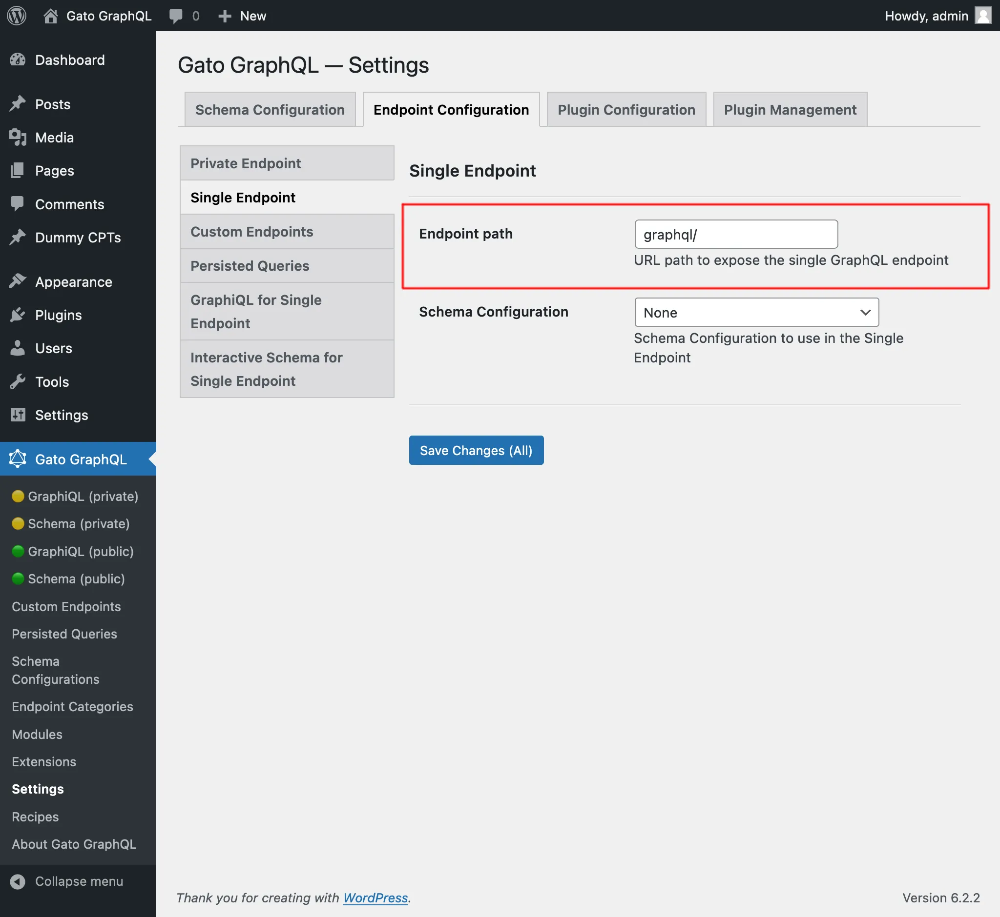

# Single Endpoint

Execute queries against the GraphQL server through the public single endpoint.

By default the endpoint is `/graphql/`, and the path can be configured through the Settings.

The path can contain letters, numbers, `-` and `_`, with `/` to separate its parts (such as `api/graphql`). A path that would break the endpoint or the site is not saved, and an error explains why. For instance:

- `gr@phql` (unsupported characters)
- `api//graphql`
- `wp-json/graphql` (handled by the WordPress REST API)
- `wp-admin`, `wp-content` or `wp-includes`
- `feed` or `rss2` (used by the WordPress feeds)
- `graphiql` (when the GraphiQL client already uses it)

The paths of the GraphiQL and Interactive Schema clients follow the same rules.

The GraphQL single endpoint can be configured by assigning a Schema Configuration to it. To do this, on section "Schema Configuration" select the desired entry from the dropdown for "Schema Configuration for the Single Endpoint":

## Clients

Interact with the single endpoint via the available clients.

### GraphiQL

If module "GraphiQL for Single Endpoint" is enabled, then the single endpoint's GraphiQL client becomes publicly available.

To open it, click on link "🟢 GraphiQL (public)" on the plugin's menu:

By default, the client is exposed under `/graphiql/`. This path can be modified on the Settings, under tab "GraphiQL for Single Endpoint":

### Interactive Schema (Voyager)

If module "Interactive Schema for Single Endpoint" is enabled, then the single endpoint's Voyager client becomes publicly available.

To open it, click on link "🟢 Schema (public)" on the plugin's menu:

By default, the client is exposed under `/schema/`. This path can be modified on the Settings, under tab "Interactive Schema for Single Endpoint":

